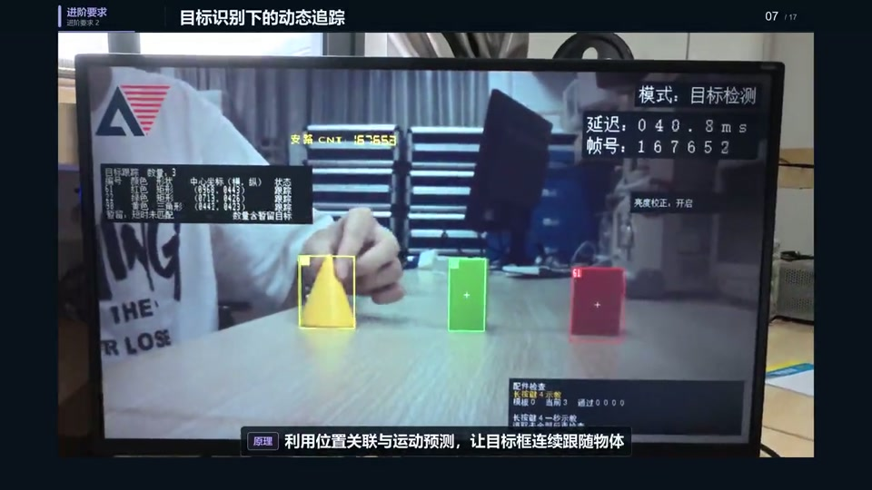

# 2026 FPGA 图像处理与双玩法交互

基于安路 PH1P35MDG324 的 FPGA 视频处理项目，在同一套摄像头输入、绿色目标检测和 HDMI 显示链路中，支持“切水果”和“跟手魔法阵”两种交互玩法。

本仓库从提供的最终版工程提取当前源码，保留必要的平台模块、IP 配置、引脚与时序约束及 ROM 素材，去掉历史版本、位流、综合布局布线数据库、日志、仿真图像结果和工具安装文件。

## 演示视频与作品海报

[](https://github.com/Yzl-916/2026FPGA-/raw/refs/heads/main/demo.mp4)

**[▶ 观看／下载完整演示视频](https://github.com/Yzl-916/2026FPGA-/raw/refs/heads/main/demo.mp4)** · **[查看作品海报合集（PDF，4 页）](project-posters.pdf)**

点击预览图或视频链接打开约 2 分 58 秒的完整演示。视频保留原音频，提供 720P 版本；PDF 保留全部页面与原始画面。

视频链接指向原始 MP4 文件，浏览器可播放或下载后观看。如果 PDF 在线预览加载较慢，可[直接下载 PDF](https://github.com/Yzl-916/2026FPGA-/raw/refs/heads/main/project-posters.pdf)。

## 主要功能

- 图像采集、ISP、白平衡、自动曝光与 HDMI 输出。
- 绿色目标检测、连通域分析、目标跟踪与显示叠加。
- 切水果：水果与炸弹、碰撞判定、计分、连击和 30 秒回合。
- 跟手魔法阵：目标跟随、停留蓄力与挥动光波。
- 灰度、增强、素描、浮雕、高斯、锐化、形态学、色温、夜视和延时显示。

两种交互玩法使用绿色小球或色块作为跟踪目标，并非裸手骨骼识别。当前顶层工程禁用运动区域蓝色高亮，旧运动模块源码保留。

## 目录

```text
user_source/
  hdl_source/             当前 RTL、视频链路与 ROM 数据
  ip_source/              PLL、FIFO 等 IP 配置和封装
  constraints_source/     引脚及原始时序约束
td_project/               TD 工程和必要的构建输入脚本
media/                    完整演示视频及预览图
docs/                     作品海报 PDF 合集
tests/                    6 个原工程核心测试平台及便携运行器
reference/                新构建的校验记录存放目录
prepare_paths.py          为本机准备工程与 ROM 路径
build_dual_candidate.ps1  原工程完整构建脚本
PACKAGE_MANIFEST.json     文件来源、路径修改和完整性清单
```

## 核心代码入口

下列文件均位于 `user_source/hdl_source/`：

| 功能 | 文件 |
| --- | --- |
| 顶层与显示集成 | `design_top_wrapper.v`、`hdmi_mixer.v` |
| 双玩法切换 | `dual_game.v`、`dual_game_control.v` |
| 切水果 | `fruit_game_core.v`、`fruit_game_display.v`、`fruit_key_control.v`、`fruit_assets.v` |
| 魔法阵 | `magic_core.v`、`magic_display.v`、`magic_assets.v` |
| 检测与跟踪 | `object_detection.v`、`object_ccl.v`、`object_tracker.v`、`object_overlay.v` |
| 图像效果 | `art_style_display.v`、`edge_morphology_display.v`、`color_temperature_display.v`、`night_live_tone.v` |

## 开发板操作

1. 切到彩图并关闭色温和夜视，短按并松开 K1 启动，默认进入切水果。
2. 进入玩法后短按 K2 切换切水果／魔法阵，切换会重新开始。
3. 短按 K1 退出；切水果结束页按 K1 可再来一局。
4. 色温开启时 K1 调暖、K2 调冷，K1＋K2 长按切换色温。
5. 切离彩图、打开色温或夜视会退出玩法。其他按键保留原工程用途。

## 打开与构建

目标器件：PH1P35MDG324。原工程工具版本：Tang Dynasty 6.2.1，Build 168116。

建议将仓库解压到不含中文或空格的路径，例如 `D:/FPGA/2026FPGA-core`，以兼容旧版 FPGA 与仿真工具。

在仓库根目录先运行：

```powershell
python prepare_paths.py
```

此命令仅更新当前解压位置对应的工程路径及五个 ROM 文件路径。随后用 TD 打开：

```text
td_project/camera_to_dsi_display.al
```

也可使用保留的完整构建脚本，将 `-TdRoot` 替换为本机安装目录：

```powershell
powershell -ExecutionPolicy Bypass -File build_dual_candidate.ps1 -TdRoot "D:/Anlogic/TD_6.2.1_Engineer_6.2.168.116"
```

首次需要完整综合与布局布线，不使用 `-ReuseSynthesis`。旧构建缓存未打包。综合数据库、位流和日志由工具重新生成。

上传或提交前，可以恢复分发时的相对路径：

```powershell
python prepare_paths.py --relative
```

## 核心仿真

安装 Python 3 和 Icarus Verilog，将 `iverilog`、`vvp` 加入 PATH 后运行：

```powershell
python tests/run_core_tests.py
```

也可以显式指定 Icarus 安装目录：

```powershell
python tests/run_core_tests.py --iverilog-dir "D:/Tools/iverilog"
```

默认运行原工程中的 6 个测试：运动模块透传、按键、切水果核心、魔法阵核心、双玩法切换与像素对照、真实绿色目标检测联动。输出位于 `build/core_tests/`，已加入 `.gitignore`。本包不包含依赖历史版本或大型测试图像的完整回归套件。

## 上传 GitHub

直接上传 ZIP 只会在仓库中保存一个压缩文件，GitHub 不会自动展开源码。若要让代码可浏览，请先解压，再上传目录中的内容，保留目录结构。

文件较多，推荐在解压后的仓库根目录使用 Git：

```powershell
git init -b main
git add .
git commit -m "Add FPGA core source"
git remote add origin https://github.com/Yzl-916/2026FPGA-.git
git push -u origin main
```

以上命令适用于当前空仓库。如果通过网页上传，请每批选择不超过 100 个文件，并分批保留目录结构；根目录的隐藏文件 `.gitignore` 也应提交。

如果已上传过核心源码，只需更新 `README.md`，并将 `media/` 和 `docs/` 一起上传到仓库根目录。视频和 PDF 均已压缩到网页单文件上传限制内；请解压项目包后上传文件，不要直接上传整个 ZIP。保留这两个目录的名称，以保证 README 中的预览图、视频和 PDF 链接有效。

## 整理与验证范围

- RTL 功能逻辑保持原样，仅将 3 个 ROM 模块的 5 个素材路径及 3 个工程配置的工程根路径改为可迁移形式。
- 必要的平台和厂商 IP 文件、原始版权声明及加密内容均保留；未新增统一开源许可证。
- 本次整理后使用 Icarus Verilog 13.0 重新运行上述 6 项核心仿真，全部通过；双玩法测试逐像素对照了 1,843,200 个像素。工程配置中的 270 条文件引用均指向现存文件，路径准备／恢复往返检查通过。详细结果见 `PACKAGE_MANIFEST.json`。不将原压缩包中的历史验收数据当成本次重新验证结果。
- 本次未使用 TD 重新综合、布局布线或烧录开发板，因此不对新路径下的完整硬件构建、板上效果或功耗作验证声明。
